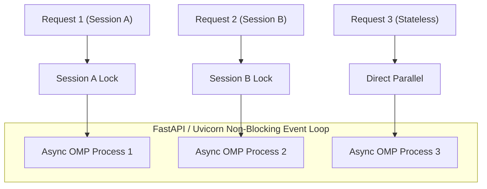

# OMP HTTP Middle Server (FastAPI)

A high-performance asynchronous HTTP middle server built with **FastAPI** and **Uvicorn** that exposes OMP (AI Coding Assistant / LLM Runner) over simple HTTP requests.

---

## Features

- **Built with FastAPI & Uvicorn**: Asynchronous ASGI server capable of high-throughput concurrent request handling.
- **Concurrent Multi-Session Execution**: Non-blocking `asyncio` subprocess execution. Requests for different sessions or stateless prompts run in full parallel without blocking each other or the event loop.
- **Race-Free Session State**: Lightweight per-session locks ensure requests to the *same* session are processed sequentially to prevent session file conflicts.
- **2 Simple Endpoints**:
  - `GET` or `POST` `/ping` for health check.
  - `POST` `/prompt` for handling AI prompts.
- **Zero Headers Required**: Accepts raw JSON bodies directly (no `Content-Type: application/json` required in `curl`).
- **Flexible JSON Payload**:
  - `{"prompt": "..."}`: Pure stateless request (fully unconstrained parallelism).
- **Text File Response with Auto-Deletion**: Each response is written to a temporary `.txt` file with a unique random UUID filename, streamed directly as the response, and automatically deleted upon delivery.
- **Multi-File Code Support**: When a coding solution requires multiple files, all files are returned within the single text file with explicit filename headers (`=== filename: path/to/file.ext ===`) for clean copy-pasting.
- **All Tools Enabled by Default**: Web search, python, filesystem, and commands run automatically with `--auto-approve`.
- **Graceful Body Fallback**: Accepts raw text or malformed JSON gracefully without 400 errors.
- **Ephemeral Sessions**: All sessions and temporary context files are deleted when the server restarts.
---

## OMP Prerequisites & Setup

Before running the server, ensure `omp` is installed, authenticated, and accessible in your environment.

### 1. Verify OMP Installation
Ensure the `omp` CLI is installed and in your system's `PATH`:
```bash
omp --version
```

### 2. Configure Model Credentials
OMP needs access to at least one LLM provider:
- **Option A: Interactive Login (Recommended)**
  ```bash
  omp login
  ```
- **Option B: Environment Variables**
  ```bash
  # Windows PowerShell
  $env:GEMINI_API_KEY = "your_key_here"   # or OPENAI_API_KEY, ANTHROPIC_API_KEY

  # Linux / macOS
  export GEMINI_API_KEY="your_key_here"
  ```
- **Option C: Auth Broker / Auth Gateway**
  ```bash
  omp auth-gateway
  ```

### 3. Verify OMP CLI Works Directly
Test that OMP responds in non-interactive print mode:
```bash
omp -p --no-tools "say hello"
```

---

## Quickstart

### 1. Install Dependencies

```bash
pip install -r requirements.txt
```

### 2. Start Server

```bash
python server.py --port 8000
```
Or directly via Uvicorn:
```bash
uvicorn server:app --host 0.0.0.0 --port 8000
```

*(Configurable via `--host 0.0.0.0`, `--port 8000`, or environment variables `PORT=8000 HOST=0.0.0.0`)*

---

## API & cURL Usage

### 1. Health Check (`/ping`)

```bash
curl http://localhost:8000/ping
```

**Response:**
```json
{"status": "pong"}
```

---

### 2. Prompt (`/prompt`)

Prompt responses are streamed as temporary text files (`.txt`) and automatically deleted after sending:

```bash
curl -d '{"prompt": "Explain quantum computing in one sentence"}' http://localhost:8000/prompt
```

**Output (clean direct text response):**
```
Quantum computing uses quantum bits to perform calculations exponentially faster than classical computers for specific problems.
```

*(Optionally, pass `curl -OJ -d '...'` to download the file directly with its random `.txt` name).*
---

### 3. Multi-Turn Session (`/prompt`)

Add the optional `"session"` key to maintain conversation history across turns:

#### Turn 1:
```bash
curl -d '{"prompt": "My favorite color is emerald green", "session": "chat123"}' http://localhost:8000/prompt
```

**Response:**
```json
{
  "response": "Understood! Emerald green is a vibrant color.",
  "session": "chat123"
}
```

#### Turn 2 (recalls Turn 1):
```bash
curl -d '{"prompt": "What is my favorite color?", "session": "chat123"}' http://localhost:8000/prompt
```

**Response:**
```json
{
  "response": "Your favorite color is emerald green.",
  "session": "chat123"
}
```

---

### 4. Full Agent Tools & Web Search (Enabled by Default)

All built-in OMP tools (web search, Python execution, file reading, bash commands) are **active by default** with auto-approval. You don't need to specify tools in your prompt or request:

```bash
# Searches web or fetches real-time data automatically
curl -d '{"prompt": "Who won the 2024 Super Bowl?"}' http://localhost:8000/prompt
```

**Optional Controls:**
- **Disable all tools** (pure offline model without tool execution):
  ```json
  {"prompt": "...", "tools": "none"}
  ```
- **Enable specific tool subset**:
  ```json
  {"prompt": "...", "tools": "web_search"}
  ```

## Concurrency Model



- **Different Sessions**: Processed concurrently in parallel.
- **Stateless Requests**: Completely lock-free, fully parallel.
- **Same Session**: Queued sequentially per session ID to preserve conversation order and avoid session file corruption.

---

## Running the Automated Test Suite

Runs all 7 end-to-end tests including concurrency benchmarks:

```bash
python test_server.py
```
